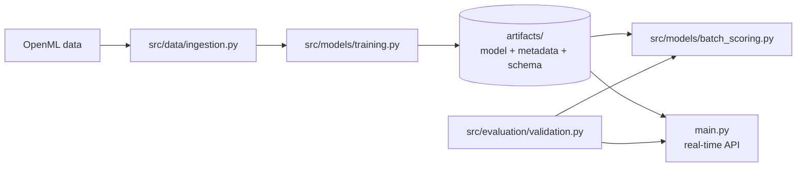

# auto-pd: Auto Loan PD Model, from Notebook to Production

A small, end-to-end machine learning engineering project that takes a credit risk **probability of default (PD)** model for auto loans and builds the production plumbing around it: a data access layer, a versioned model artifact, a data contract with validation, batch scoring, a real-time scoring API, and a reproducible one-command pipeline.

The model itself is intentionally simple (logistic regression). The point of this project is everything *around* the model, the part that keeps a model working reliably, consistently, and auditably after development is done.

> This is a learning project built step by step while studying MLOps and cloud model deployment, written from the perspective of a credit risk modeler. It is not a production credit model.

---

## What this project demonstrates

| MLOps stage | How it is implemented here |
|---|---|
| Data access | `src/data/ingestion.py` loads and splits data |
| Training | A scikit-learn pipeline that bundles preprocessing and the model into one artifact |
| Packaging | A serialized model plus metadata recording version, data fingerprint, and environment |
| Data contract | An input schema generated from training data and saved alongside the model |
| Validation | Two-tier checks: hard errors block scoring, warnings flag extrapolation |
| Batch serving | A scheduled-style scoring job with lineage on every output row |
| Real-time serving | A FastAPI service that scores one application in a few milliseconds |
| Reproducibility | Pinned packages, a data hash, and a single pipeline script that stops on failure |



---

## Project structure

```text
auto-pd/
├── configs/
│   └── settings.py             # Shared paths, features, and model settings
├── data/
│   ├── raw/                    # Optional raw local inputs; not committed
│   └── processed/              # Optional derived data; not committed
├── src/
│   ├── data/ingestion.py       # OpenML loading and data split
│   ├── features/pipeline.py    # Preprocessing and estimator pipeline
│   ├── models/
│   │   ├── training.py         # Fit model and write artifacts
│   │   ├── batch_scoring.py    # Validate and score a batch
│   │   ├── api_service.py      # FastAPI health and scoring endpoints
│   │   ├── mlflow_training.py  # Track experiments and register models
│   │   ├── mlflow_scoring.py   # Score using the champion model alias
│   │   ├── model_registry.py   # Promote and list model versions
│   │   ├── prepare_batch_data.py # Validate CSV and export JSON Lines
│   │   └── monitor_batch.py    # PSI drift and matured-outcome monitoring
│   └── evaluation/
│       ├── metrics.py          # AUC and Gini metrics
│       ├── monitoring.py       # PSI profiles and calibration calculations
│       └── validation.py       # Input schema and validation rules
├── tests/                      # Pytest validation and reproducibility suite
├── scripts/
│   ├── client.py               # Simulated dealer calling the scoring API
│   ├── databricks/
│   │   ├── train_uc.py          # Train and register a Unity Catalog model
│   │   ├── promote_uc_model.py  # Set the champion model alias
│   │   └── score_batch.py       # Distributed Spark scoring to Delta
│   └── aws/
│       ├── package_model.sh    # Package local artifacts for SageMaker
│       ├── push_image_to_ecr.sh
│       ├── deploy_endpoint.sh
│       └── run_batch_transform.sh
├── .github/workflows/ci.yml    # Run tests and build the API image on GitHub
├── .github/workflows/deploy-aws.yml # Gated manual SageMaker deployment
├── databricks.yml              # Databricks Asset Bundle jobs
├── artifacts/                  # Generated model, metadata, and schema
├── output/                     # Generated scores and validation reports
├── main.py                     # FastAPI application entry point
├── run_pipeline.sh             # Train, test, and batch-score workflow
└── Dockerfile                  # Container image for the scoring API
```

| Component | Responsibility |
|---|---|
| `data/` | Optional storage for raw and processed data; the current pipeline fetches its data from OpenML and does not commit dataset copies |
| `configs/` | Centralize shared paths, feature names, seeds, and model settings |
| `src/data/` | Load source data and create history/application splits |
| `src/features/` | Build numeric scaling and categorical encoding transformations |
| `src/models/` | Train models, score batches and API requests, and manage MLflow versions |
| `src/evaluation/` | Compute model metrics and enforce the input data contract |
| `tests/` | Verify validation behavior and deterministic training |
| `artifacts/` | Store generated model, metadata, and input schema |
| `main.py` | Expose the FastAPI application for local serving and Docker |

Only the API and pipeline orchestration remain as root entry points. Training,
scoring, evaluation, and MLflow operations live in their corresponding `src/`
packages.

---

## Data

The project uses the public **German Credit** dataset (OpenML `credit-g`, version 1), loaded directly from the web with no manual download. Only loans whose purpose is **new car** or **used car** are kept, giving roughly 337 auto loans with a known good or bad outcome.

To mimic a real workflow, 30% of loans are held back as "new applications" with the outcome removed. These play the role of next month's originations to be scored.

Attributes that encode sex, marital status, or national origin (`personal_status`, `foreign_worker`) are deliberately excluded from the model features, reflecting fair lending considerations under ECOA.

---

## Quick start

Requires **Python 3.12**.

```bash
git clone https://github.com/purirajan/auto-pd.git
cd auto-pd

python3.12 -m venv .venv
source .venv/bin/activate
pip install -r requirements.txt

./run_pipeline.sh
```

`run_pipeline.sh` trains the model, runs the pytest suite, scores the new applications, and generates a PSI monitoring report. It stops immediately if any step fails.

GitHub Actions runs the same pipeline and builds the Docker image on pushes to `main`, pull requests, or manual dispatch. The workflow downloads the public dataset from OpenML during training.

Outputs:

- `artifacts/pd_model.joblib`: the trained model
- `artifacts/model_metadata.json`: version, training date, features, AUC, data hash, environment
- `artifacts/input_schema.json`: the model's data contract
- `artifacts/monitoring_profile.json`: training feature distributions for PSI
- `output/scored_applications.csv`: PDs with model version and timestamp
- `output/validation_report.json`: pass or fail status, errors, and warnings for the batch

---

## Real-time scoring API

Start the server:

```bash
python -m uvicorn main:app --reload
```

Then open **http://127.0.0.1:8000/docs** for an interactive page where you can send test applications from the browser.

### Endpoints

| Method | Path | Purpose |
|---|---|---|
| `GET` | `/health` | Confirms the service is running and reports the model version |
| `POST` | `/score` | Scores a single auto loan application |

### Example request

```json
{
  "loan_id": 5001,
  "duration": 36,
  "credit_amount": 5000,
  "installment_commitment": 3,
  "age": 35,
  "existing_credits": 1,
  "purpose": "used car",
  "checking_status": "0<=X<200",
  "credit_history": "existing paid",
  "savings_status": "<100",
  "employment": "1<=X<4",
  "housing": "own"
}
```

### Example response

```json
{
  "loan_id": 5001,
  "pd": 0.2665,
  "model_version": "1.0",
  "scored_at": "2026-10-03T13:14:39",
  "warnings": []
}
```

An invalid application returns HTTP `422` with every problem listed:

```json
{
  "detail": {
    "errors": [
      "age: 1 values outside allowed range [18, 100]",
      "purpose: unknown categories ['boat']; allowed are ['new car', 'used car']"
    ]
  }
}
```

With the server running, `python scripts/client.py` simulates a dealer origination system: it checks health, scores a valid and an invalid application, and measures average response time (about 4 ms locally).

### MLflow experiments and registry

Run a tracked training experiment (optionally pass a different logistic-regression regularization value):

```bash
python -m src.models.mlflow_training 0.1
python -m src.models.model_registry
python -m src.models.model_registry 1
python -m src.models.mlflow_scoring
```

The registry command without a version lists model versions; with a version, it assigns that version the `champion` alias. MLflow state is stored in the local `mlflow.db` database.

### Run the API with Docker

Generate the model artifacts first, then build and start the API container:

```bash
./run_pipeline.sh
docker build -t auto-pd-api .
docker run --rm -p 8000:8080 auto-pd-api
```

Open **http://127.0.0.1:8000/docs** to try the API. The image includes the generated model and schema, runs as a non-root user, and has a `/health` container health check. Rebuild the image after retraining to package updated artifacts.

### AWS SageMaker endpoint (initial deployment step)

The API container implements SageMaker's `/ping` health route and `/invocations` inference route. These scripts prepare the model package, push an x86-64 image to ECR, and create or update a real-time SageMaker endpoint:

```bash
./run_pipeline.sh
export AWS_REGION=us-east-1
export AWS_ACCOUNT_ID="$(aws sts get-caller-identity --query Account --output text)"
export SAGEMAKER_EXECUTION_ROLE_ARN=arn:aws:iam::<account-id>:role/<sagemaker-execution-role>
./scripts/aws/package_model.sh
aws s3 cp deployment/aws/build/model.tar.gz s3://<your-model-bucket>/auto-pd/model.tar.gz
export MODEL_DATA_URL=s3://<your-model-bucket>/auto-pd/model.tar.gz
export IMAGE_TAG="$(git rev-parse --short HEAD)"
./scripts/aws/push_image_to_ecr.sh
./scripts/aws/deploy_endpoint.sh
```

The AWS CLI must be configured with permissions for ECR, S3, and SageMaker, and the execution role must allow SageMaker to read the model object and pull the ECR image. Set `SAGEMAKER_INSTANCE_TYPE` and `SAGEMAKER_INSTANCE_COUNT` to override the deployment defaults. Endpoint hosting is billable for as long as the endpoint is running; delete it when finished. No AWS resources are created by local tests or CI.

For a gated GitHub Actions release, configure repository variables `AWS_REGION`, `AWS_DEPLOY_ROLE_ARN`, `SAGEMAKER_EXECUTION_ROLE_ARN`, `MODEL_ARTIFACTS_BUCKET`, and `SAGEMAKER_ENDPOINT_NAME`. Optionally set `SAGEMAKER_INSTANCE_TYPE` and `SAGEMAKER_INSTANCE_COUNT`. Configure the AWS deployment role to trust this repository's GitHub OIDC identity, with only the required ECR/S3/SageMaker permissions and `iam:PassRole` limited to the SageMaker execution role. Protect the GitHub `production` environment with required reviewers. Then manually run **Deploy AWS SageMaker endpoint** and explicitly select `yes`; it trains and tests, uploads a commit-specific model package and immutable image tag, and creates or updates the endpoint. Selecting `no` creates no AWS resources. Endpoint compute starts billing after deployment succeeds and remains billable until the endpoint is deleted.

#### SageMaker Batch Transform

For offline scoring, prepare a CSV containing `loan_id` and all model features, then convert it to validated JSON Lines. Upload the input and model package to S3, push the image to ECR as above, and submit a transform job:

```bash
python -m src.models.prepare_batch_data \
  --input-csv data/processed/applications.csv \
  --output-jsonl output/aws_batch/applications.jsonl
aws s3 cp deployment/aws/build/model.tar.gz s3://<your-model-bucket>/auto-pd/model.tar.gz
aws s3 cp output/aws_batch/applications.jsonl s3://<your-batch-bucket>/auto-pd/input/applications.jsonl
export MODEL_DATA_URL=s3://<your-model-bucket>/auto-pd/model.tar.gz
export BATCH_INPUT_S3_URI=s3://<your-batch-bucket>/auto-pd/input/
export BATCH_OUTPUT_S3_URI=s3://<your-batch-bucket>/auto-pd/results/<unique-run-prefix>/
./scripts/aws/run_batch_transform.sh
```

The job reads newline-delimited application objects and writes one JSON result per line under the output prefix. Use a new output prefix for each job. Override the default batch instance and concurrency with `BATCH_INSTANCE_TYPE`, `BATCH_INSTANCE_COUNT`, `BATCH_MAX_CONCURRENT_TRANSFORMS`, and `BATCH_MAX_PAYLOAD_MB`. Batch Transform runs only for the job duration rather than leaving a real-time endpoint up, but the instances and S3 storage are still billable. The job creates a SageMaker model resource; remove it after the job if it is no longer needed.

### Databricks foundation (Unity Catalog and scheduled Spark scoring)

The Databricks Asset Bundle defines a UC model training job and a paused scheduled PySpark scoring job. Before deploying, install and authenticate the Databricks CLI, select a Unity Catalog catalog/schema, and create a volume for batch inputs and outputs:

```sql
CREATE SCHEMA IF NOT EXISTS main.mlops;
CREATE VOLUME IF NOT EXISTS main.mlops.auto_pd;
```

Then validate/deploy the bundle, run training, and promote the registered UC model version after reviewing its metrics:

```bash
databricks bundle validate -t dev
databricks bundle deploy -t dev
databricks bundle run train_unity_catalog_model -t dev
```

Upload an applications CSV (including `loan_id` and all model features) to `/Volumes/main/mlops/auto_pd/input/applications.csv`. Update the job's `input_path` and `output_path` parameters if using another volume. The scheduled job is intentionally paused by default; run it manually after promoting a model, or enable its schedule only after workspace-specific review:

```bash
export MLFLOW_TRACKING_URI=databricks
export MLFLOW_REGISTRY_URI=databricks-uc
export MODEL_NAME=main.mlops.auto_pd
python scripts/databricks/promote_uc_model.py <registered-version>
databricks bundle run scheduled_pyspark_scoring -t dev
```

The Spark scorer validates its input with distributed checks, predicts through a Pandas UDF, and writes versioned lineage fields to a unique Delta output folder in the UC Volume. Training fetches the public dataset from OpenML, so the job cluster needs outbound access. Cluster compute and storage are billable. This is a deployment foundation, not a live Databricks deployment: credentials, Unity Catalog permissions, cloud resources, and a Databricks Model Serving endpoint still need workspace-specific setup.

---

## Validation design

Every batch and every API request passes through the same `validate()` function, so batch and real-time scoring always apply identical rules.

**Errors block scoring.** These include missing columns, missing or non-numeric values, values outside business limits (for example, age outside 18 to 100), and categories the model has never seen. Unknown categories are especially important to catch, because the one-hot encoder would otherwise score them silently.

**Warnings allow scoring but flag it.** A value that is plausible but outside the range seen in training means the model is extrapolating. The score is produced, and the warning is recorded in the validation report for review.

Run `pytest -q` to exercise the validator and check that training twice with the same seed produces identical predicted PDs. Validation and metrics are implemented in `src/evaluation/`.

### Drift and calibration monitoring

Training also writes `artifacts/monitoring_profile.json`, with numeric quantile bins and categorical shares from the training split. Batch scores now retain the input features so they can be compared with that baseline. Run:

```bash
python -m src.models.monitor_batch
```

The report at `output/monitoring_report.json` includes per-feature population stability index (PSI), warning/critical shift alerts, and a retraining recommendation for review. PSI of 0.1 is treated as a warning and 0.25 as critical. Calibration metrics (observed default rate, mean predicted PD, Brier score, and AUC when both classes are present) are calculated only after a `default_flag` column is joined to the scored CSV by `loan_id` once outcomes mature; at least 30 labeled rows are required. The tool only recommends review—it does not trigger retraining. This is a local monitoring foundation, not scheduled production monitoring.

---

## Reproducibility

Each trained model records what produced it in `model_metadata.json`:

- model version and training date
- feature list and test AUC
- a SHA-256 fingerprint of the training data
- Python, scikit-learn, and pandas versions

Combined with pinned dependencies in `requirements.txt` and fixed random seeds, rebuilding the project from a clean clone produces identical PDs. Model artifacts and outputs are excluded from Git: the repository holds the code that builds the model, not the model itself.

---

## Limitations

- **Small sample.** About 337 loans is far too few for a real PD model, and test-set AUC is noisy.
- **Not US auto data.** German Credit is a classic benchmark, not a modern US auto portfolio.
- **Baseline model.** Logistic regression with default settings, with no binning, variable selection, caps and floors, or calibration work.
- **Local only, so far.** Deployment scripts and local drift/calibration reporting exist, but there is no live cloud deployment, authentication, or scheduled production monitoring.

---

## Roadmap

- [x] Batch scoring with a saved model artifact and lineage
- [x] Data contract and two-tier input validation
- [x] Real-time scoring API with a health endpoint
- [x] Reproducible pipeline with pinned dependencies and a data fingerprint
- [x] Experiment tracking and model registry with MLflow
- [x] Containerization with Docker
- [ ] Deploy on AWS (manual, approval-gated GitHub deployment is configured; first account deployment and cost review remain)
- [ ] Deploy on Databricks (UC and scheduled Spark job foundations added; provision workspace resources and Model Serving endpoint)
- [x] Automated tests with pytest
- [x] Continuous integration with GitHub Actions (tests and container build)
- [x] Continuous deployment foundation (approval-gated manual AWS release workflow)
- [ ] Production monitoring for data drift (local PSI/calibration report foundation added) and a governed retraining trigger
- [ ] Larger, real US auto loan data from SEC EDGAR asset-backed securities filings

---

## Disclaimer

This is a personal project, built on my own time and equipment for educational purposes only. It uses only publicly available data (the OpenML German Credit dataset) and contains no proprietary data, code, models, or methodologies from any current or former employer. It is not affiliated with or endorsed by any employer, and the views and approaches here are my own. Nothing in this repository is intended for production lending decisions.
